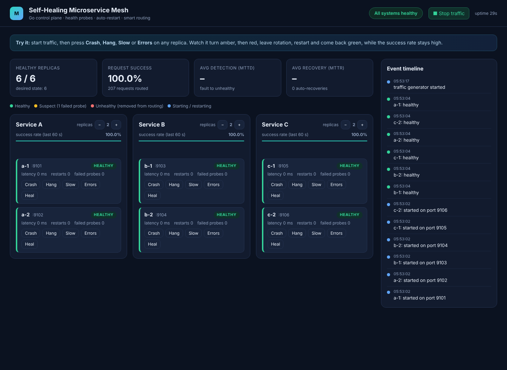
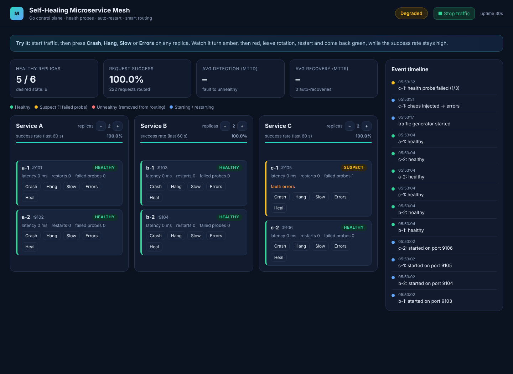
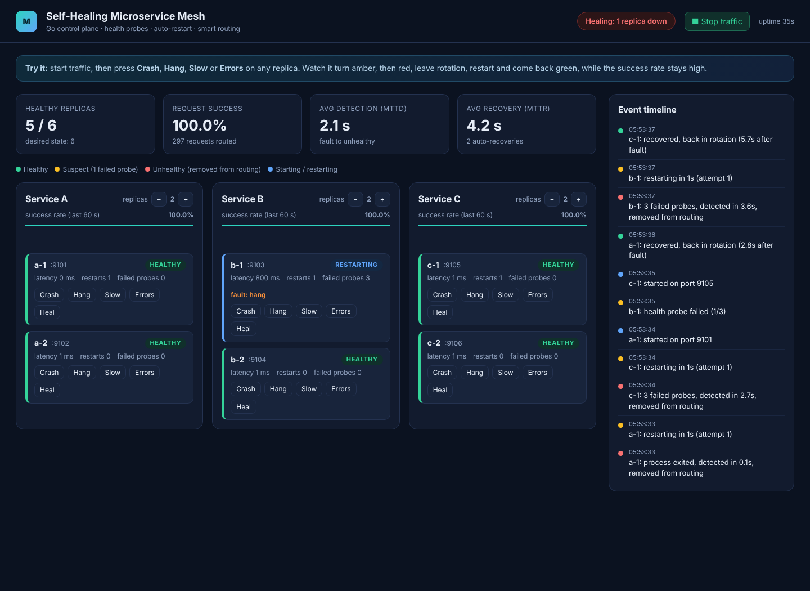
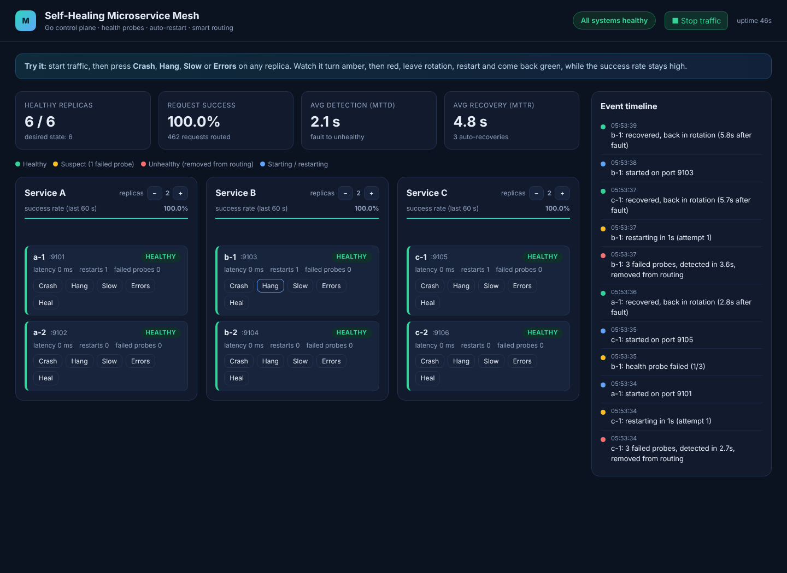
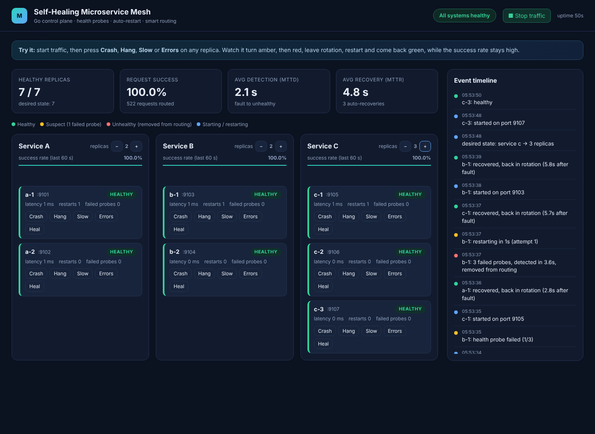

# Self-Healing Microservice Mesh

A small, fully working **self-healing microservice system written in Go**.

A group of deliberately fragile microservices is monitored by a Go **control plane** that detects failures through goroutine-based health checks, automatically restarts broken services, and re-routes traffic to healthy replicas.

**Phase-II Capstone Project**

## Team Members

| Name | Student ID |
|---|---|
| Tripti | 2301010278 |
| Rizpah | 2301010219 |
| Raghuveer | 2301010268 |
| Ayush | 2301010253 |
| Aman | 2301010277 |
| Sarthak | 2301010216 |

## 1. Objectives

- Detect service failures such as crashes, hangs, slow responses, and errors.
- Recover automatically without manual intervention.
- Route traffic only to healthy replicas.
- Provide observability through a live dashboard and event timeline.
- Demonstrate Go concurrency concepts in a practical system.

## 2. Key Features

- **Fragile Microservices:** Three services (A, B, C), with two replicas each.
- **Health Monitoring:** Concurrent health checks using goroutines.
- **Failure Detection:** Identifies unhealthy instances through repeated failed probes.
- **Automatic Restart:** Restarts failed service processes.
- **Smart Routing:** Routes requests to healthy replicas.
- **Reconciliation Loop:** Compares desired and actual system states.
- **Chaos Controls:** Simulates failures such as crashes and hangs.
- **Live Dashboard:** Displays service health and recovery activity.

## 3. Technologies Used

- Go (Golang)
- Goroutines and concurrent programming
- HTTP and REST APIs
- Context and timeouts
- Mutex and atomic operations
- HTML, CSS, and JavaScript

## 4. System Architecture

The system consists of:

- **Client:** Sends requests to the application.
- **Router / Load Balancer:** Routes traffic to healthy service instances.
- **Microservices:** Service A, Service B, and Service C.
- **Chaos Injector:** Simulates service failures.
- **Control Plane:** Monitors services and manages recovery.

### Control Plane Components

- **Prober:** Checks the health of service instances.
- **Reconciler:** Compares desired and actual system states.
- **Supervisor:** Restarts failed services and manages recovery.

## 5. Reconciliation Loop

The control plane follows four stages:

1. **Observe:** Collect health probe results.
2. **Compare:** Compare desired and actual replica states.
3. **Act:** Restart failed services and update routing.
4. **Wait:** Wait for the next tick and repeat the process.

The loop is level-triggered, meaning it acts on the current system state rather than relying only on individual events.

## 6. Failure Recovery Workflow

1. A service instance crashes or becomes unhealthy.
2. Health probes detect repeated failures.
3. The instance is marked unhealthy.
4. It is removed from traffic routing.
5. The supervisor restarts the service.
6. After successful health checks, it rejoins traffic rotation.

## 7. How to Run

### Prerequisites

- Go 1.22 or newer installed.

### Clone the Repository

```bash
git clone https://github.com/triptikhandelwal1/self-healing-microservice-mesh.git
cd self-healing-microservice-mesh
```

### Start the Control Plane

```bash
go run ./cmd/controlplane
```

Open the dashboard in your browser:

```text
http://localhost:8080
```

Keep the terminal running while using the dashboard. Press `Ctrl+C` to stop the application.

## 8. Screenshots

### Healthy Dashboard



### Suspect Replica



### Failure Detection and Healing



### Self-Healed Replica



### Scaled Desired State



## 9. Project Documentation

The project presentation is available in the repository as `Self_Healing_Mesh_ppt.pdf`.

## 10. Future Scope

- Leader election for multiple control-plane instances.
- Container-based service management.
- Automatic scaling.
- Prometheus metrics integration.
- Further dashboard enhancements.

---

**Project:** Self-Healing Microservice Mesh  
**Language:** Go  
**Evaluation:** First Evaluation